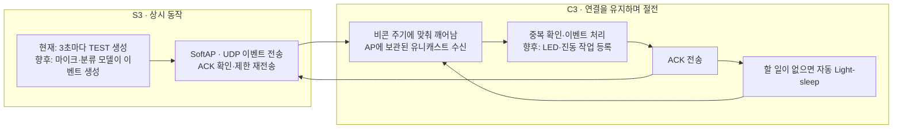

# Hearing Alert 시스템 구조와 절전 통신

## 현재 구현과 최종 제품의 관계

2026-11-15부터 제품용 통신 펌웨어를 두 개의 ESP-IDF 프로젝트로 나눴다. `firmware/transmitter_s3/`(S3 SoftAP·송신)와 `firmware/receiver_c3/`(C3 STA·수신)이 공통 코어 `firmware/common/ha_comm/`을 함께 쓴다. `communication_tests/softap_udp/`는 칩 타깃에 따라 같은 소스를 S3/C3로 빌드하는 TEST 실험 프로젝트이며, 과거 기록·회귀 참고용으로 보존한다. 제품 펌웨어는 이 실험 코드를 포함하지 않는다.

```text
ML/제어(후속) ─ha_publish_event(id)→ S3 대기열 ─EVENT(v1 16B, 반복 송신)→ C3 검증·중복 확인
                                       ↑                                     │ UI 큐 접수 성공 시
                                       └──────── ACK(session·seq·id) ────────┘
                                                                   C3 UI 소비자(후속) ← ha_receiver_wait_alert()
```

아래 그림과 절전 설명은 TEST 실험(DTIM=1) 기준의 기존 기록이다. 제품 펌웨어는 DTIM=3을 쓴다.



## 절전의 정확한 의미

- S3는 AP와 향후 소리 감지를 유지한다. 이번 절전 적용 대상은 C3다.
- C3는 `WIFI_PS_MIN_MODEM`과 동적 CPU 주파수 40~160MHz, FreeRTOS tickless idle, 자동 Light-sleep을 사용한다.
- (TEST 실험) S3는 100 TU(약 102.4ms) 비콘, DTIM=1로 설정한다. **제품 펌웨어는 DTIM=3이며, MIN_MODEM C3의 명목 수신 간격은 307.2ms다(2026-11-10 회의의 약 300ms 목표, 정확히 300ms는 설정할 수 없음).** C3는 주기적으로 깨어나 Wi-Fi 연결을 유지하며, AP는 절전 STA에 대한 UDP 유니캐스트를 버퍼링한다. 전파 한 번으로 완전히 꺼진 칩을 깨우는 방식은 아니다.
- 이벤트 수신 작업이 준비되면 CPU가 처리하고 ACK를 전송한다. Wi-Fi 드라이버가 필요한 전력 관리 잠금을 관리하며, 다시 유휴 상태가 되면 자동 절전한다.
- Deep-sleep은 사용하지 않는다. Wi-Fi가 완전히 꺼진 Deep-sleep 중에는 이 UDP 패킷으로 즉시 깨울 수 없다.
- 부팅 후 15초까지는 CPU 자동 Light-sleep을 미뤄 업로드·부팅 로그 확인 시간을 둔다. Wi-Fi Modem-sleep은 접속 후부터 사용한다.
- C3의 HELLO는 10초 간격이며 S3의 수신부 응답 없음 판단은 35초다. 주소·미전달 이벤트는 유지하고 재전송한다. C3는 끊김 감지 즉시 재접속을 시도하고 IP 획득 시 HELLO 전용 작업을 깨운다. 이는 낮은 전력 소비와 빠른 단절 감지 사이의 초기 절충값이다.

## 현재 검증하는 것

`TX seq=N` → C3 이벤트 처리 → `ACK seq=N`의 일치, 재전송·실패 수, ACK 왕복 시간, 실제 Light-sleep 성공 횟수 증가를 확인한다. ACK는 C3 소프트웨어의 수신 처리 확인이며, 알림장치 동작이나 사용자의 인지를 보증하지 않는다.

C3는 ESP-IDF 공개 API `esp_pm_dump_locks()`의 프로파일링 결과에서 성공/거절 횟수를 읽어 S3에 보고한다. `C3_STATE ... auto_light_sleep=1`은 설정 확인이고 `C3_PM ... sleep_count=N`의 증가는 실제 수면 진입 성공의 증거다. 전류 감소율·배터리 수명은 전류계로 별도 측정해야 한다.

ESP32-C3 내장 USB Serial/JTAG는 Light-sleep 중 정상 응답하지 않을 수 있다. 실제 절전 검증 빌드는 USB 연결에 의한 절전 차단을 사용하지 않는다. 모니터 오른쪽은 C3 USB 로그와 S3가 수신한 C3 상태·ACK를 함께 표시하며, USB 로그가 멈춰도 무선 상태 보고를 확인할 수 있다.

## 최종 펌웨어 통합 순서

2026-11-15 상태: 2단계(공용 컴포넌트 분리)와 3·4단계의 통신 쪽 인터페이스를 구현했다. S3의 `ha_publish_event()`와 C3의 `ha_receiver_attach_consumer()`/`ha_receiver_wait_alert()`가 그것이다. ML 판정 연결과 LED·표시·진동 드라이버는 각 팀의 후속 작업이며, 5단계 실기기 재검증도 남아 있다. 아래 순서는 기존 계획 기록이다.


1. 통신 실험에서 절전·수신·ACK·재접속을 검증하고 결과를 기록한다.
2. 향후 통신·프로토콜·전력 관리 부분을 공용 ESP-IDF 컴포넌트로 분리해 두 최종 펌웨어에서 재사용한다. 현재 단계에서 오디오·알림 구현을 했다는 뜻은 아니다.
3. S3의 TEST 생성부를 소리 분류 결과를 보내는 이벤트 생성부로 교체한다.
4. C3의 TEST 처리부에서 LED·진동 작업을 등록하도록 연결한다. 알림 실행 완료 ACK가 필요하다면 현재의 수신 처리 ACK와 구분해 프로토콜을 확장한다.
5. 실제 알림 부하와 배터리 전원에서 지연·소비전류·재접속을 다시 검증한다.

참고: [Espressif Wi-Fi 저전력 가이드](https://docs.espressif.com/projects/esp-idf/en/v5.5/esp32c3/api-guides/low-power-mode/low-power-mode-wifi.html), [USB Serial/JTAG의 절전 제한](https://docs.espressif.com/projects/esp-idf/en/v5.5/esp32c3/api-guides/usb-serial-jtag-console.html).
