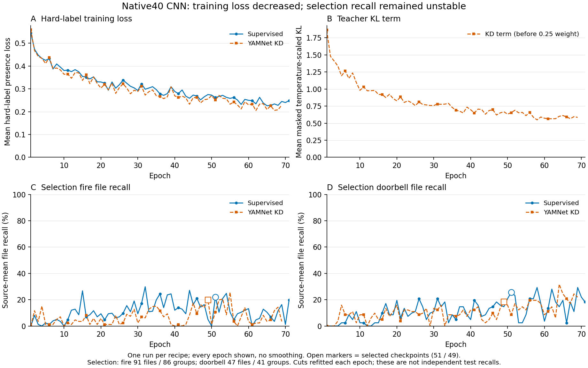

# 모델 개발·학습 진행 상황 — 2026-11-14

PC에서 YAMNet 기준 학습, 경량 DS-CNN 학습·개선·공개 자료 확장·비교와 실제 int8 변환을 완료했다. 후속 `pursuit_20261114` 연구는 optimizer 업데이트가 확인된 학습 33회와 BN 통계 보정 2건까지 기록돼 있다. 최신 전체 후보는 **`native40_r06_v1`**이며 통신 연결 준비용 모델·출력 정책·체크포인트를 저장소에서 받을 수 있다. 실제 마이크와 최종 장치의 감지·알림 신뢰도는 아직 검증하지 않았다.

## 완료한 개발 단계

| 단계 | 완료 내용 | 결과 기록 |
|---|---|---|
| YAMNet 기준 모델 | frozen backbone embedding + 3-class head, 국내 가중치 1·2·4의 4-fold 비교, 가중치 1 최종 refit·기존 test 평가 | [CV](../../ml/training/yamnet/reports/ubuntu_gpu_cv_s42_official221_20261109T163208Z/REPORT_KO.md), [최종 평가](../../ml/training/yamnet/reports/gpu_refit_final_w1_s42_official221_20261109T164741Z/REPORT_KO.md) |
| DS-CNN 소프트웨어 기반 | 1초 log-Mel·경량 CNN·int8 변환·portable C++ frontend·runner, 합성 host 검증 | [소프트웨어 기록](../../ml/training/dscnn/reports/software_v1/REPORT_KO.md) |
| 실제 파일 라벨 baseline | 새 국내 초인종 5개를 포함한 개발 분할, 가중치 1·2·4의 12개 fold, 19 epoch refit·int8 변환 | [실제 학습 기록](../../ml/training/dscnn/reports/real_training_20261114/REPORT_KO.md) |
| distillation 개선 | YAMNet teacher KL loss·주파수 정보 보존·증강, 4후보×4-fold, 9 epoch refit | [개선 기록](../../ml/training/dscnn/reports/improvement_20261114/REPORT_KO.md) |
| 공개 정답 확장 | 공개 음원 39개 추가·학습 사이렌 24개의 정답 정의 반영·국내 그룹 4배 가중치, teacher 재학습·두 구조 비교 | [확장 기록](../../ml/training/dscnn/reports/expansion_20261114/REPORT_KO.md) |
| 순차 비교 연구 | 집계 방식·데이터 구성·KD 비중·구조·학습 길이 비교, 별도 calibration·고정 공개 평가 | [비교 기록](../../ml/training/dscnn/reports/comparison_20261114/REPORT_KO.md) |
| 후속 연구 1단계 | 국내 특화·증강·사전학습 가중치 전이 등 29회 학습과 4종 정수 모델·고정 공개 녹음 1,959개 평가 | [첫 고정 평가](../../ml/training/dscnn/reports/pursuit_20261114/FINAL_REVIEW_KO.md) |
| 후속 연구 2단계 | full YAMNet teacher·실제 학생 distillation·비증류 대조군·BN 보정·정수 출력 비교·새 공개 559개 평가·출력 결합 실험 | [최신 결과](../../ml/training/dscnn/reports/pursuit_20261114/STAGE2_REVIEW_KO.md) |

33회는 위 표 마지막 두 단계의 누적 optimizer 학습 횟수다. 이전 baseline의 fold 수나 저장한 체크포인트 수와 같은 지표가 아니다. 후속 증류 학생은 69 epoch·2,760 optimizer update를 수행했고 epoch 49를 선택했다. 비증류 대조군은 71 epoch 중 epoch 51을 선택했다. BN 보정은 학습 창의 moving statistics만 다시 계산한 것으로 새 optimizer 학습 2회로 세지 않는다.

그림은 저장된 모든 epoch의 손실과 선택 자료 지표다. 독립 시험 곡선이 아니며 원래 생성된 그림과 해시를 보존했다.

## 실제 모델과 체크포인트

| 위치 | 내용 |
|---|---|
| [`ml/models/pursuit_20261114/`](../../ml/models/pursuit_20261114/README.md) | 최신 전체 후보와 국내 특화·증류·비증류 비교 int8 묶음, 9개 폴더(동일 모델 alias 1개 포함) |
| [`ml/models/checkpoints_20261114/`](../../ml/models/checkpoints_20261114/README.md) | YAMNet 22개·DS-CNN 계열 105개, 총 127개 원본 `.keras` 및 실행별 작은 요약·이력 |
| [`dscnn_filelabels_20261114`](../../ml/models/dscnn_filelabels_20261114/README.md) | 초기 실제 파일 라벨 baseline |
| [`dscnn_improved_20261114`](../../ml/models/dscnn_improved_20261114/README.md) | 초기 YAMNet distillation 개선 실험 |
| [`dscnn_expanded_20261114`](../../ml/models/dscnn_expanded_20261114/README.md) | 공개 정답 확장·temporal24 실험 |
| [`dscnn_comparison_20261114`](../../ml/models/dscnn_comparison_20261114/README.md) | 순차 비교 연구에서 선택한 freq24 실험 |

체크포인트 색인에는 smoke/integration 확인용 실행도 명시했다. 원본 `.keras`, 기존 모델 묶음, 전처리·판정 정책을 덮어쓰지 않고 별도로 보관했다. `.keras`가 존재한다는 이유로 배포 가능 모델이라고 표시하지 않는다. 합성 `pipeline_only*`와 실제 학습 모델도 구분한다.

## 평가 결과를 읽는 기준

이전 YAMNet의 기존 test 411개에서 화재경보는 **4/4**, 초인종은 **3/4**, 해외 other 오탐은 **9/402**였다. 초기 DS-CNN의 평균 타깃 recall은 50%, distillation 개선과 확장 모델은 62.5%였다. 개선 모델의 해외 비목표 오탐은 siren 8개를 제외한 수정 범위에서 **24/394**, 확장 모델은 **46/394**였다. test 구성과 판정 단위가 다르므로 후속 표와 한 줄의 성능 순위로 합치지 않는다.

가장 최근 공개 시험의 전체 파일 수는 **559개**다. 모델·readout·임계값을 선택·보정한 뒤 평가 코드를 고정하고 실행한 기록이다. 이미 결과를 관측했으므로 이후 새 미관측 시험으로 재사용할 수 없다.

| 고정 int8 후보 | 화재경보 감지 파일 / 41 | 초인종 감지 파일 / 6 | 기타 오감지 파일 / 512 |
|---|---:|---:|---:|
| domestic_known_v1 | 1 | 1 | 3 |
| domestic_known_aug_v2 | 0 | 1 | 1 |
| domestic_known_enriched_v3 | 0 | 1 | 0 |
| general_prefix64_v1 | 17 | 0 | 2 |
| native40_r06_supervised_v1 | 4 | 1 | 0 |
| native40_r06_distilled_v1 | 5 | 4 | 0 |
| **native40_r06_v1** (= supervised_bnrefit) | **8** | **1** | **0** |
| native40_r06_distilled_bnrefit_v1 | 6 | 4 | 1 |

원본은 [`stage2_public_benchmark_v1/results.json`](../../ml/training/dscnn/reports/pursuit_20261114/stage2_public_benchmark_v1/results.json)에 있다. 파일 안에서 한 번이라도 감지했는지를 센 값이며 실제 경보 발생·버튼 누름의 감지율이 아니다. 기타 0/512도 장치당 월간 오알림 0회를 뜻하지 않는다. 초인종은 6개뿐이며 실제 기기 국가·foundation 사전학습 미노출까지 증명하지는 않는다.

국내 특화 후보 `domestic_known_v1`는 학습에 사용한 국내 원음 17개 화재·26개 초인종을 int8에서 모두 감지했다. 새 공개 시험에서는 위 표처럼 낮아졌으므로 43/43을 독립 성능으로 제시하지 않는다. 최신 전체 후보도 국내 원음 진단에서 화재 **0/17**, 초인종 **16/26**이었다. 국내 CNN과 일반 CNN의 출력 결합 실험도 수행했지만 새 공개 시험에서 화재 0/41·초인종 0/6으로 채택하지 않았다.

실제 distillation을 수행했지만 선택 자료에서 비증류 기준선을 일관되게 넘지 못했다. 새 공개 시험에서 일부 감지가 높아진 결과와 선택 자료의 결과를 함께 보관한다. epoch를 늘리거나 임계값을 낮추면 제품 목표를 달성한다고 결론내리지 않는다.

## 데이터·환경·통신 보존 범위

학습 원음·대규모 특징 캐시·가상환경은 로컬 연구 자료로 유지한다. 저장소에는 학습 코드·설정·선택한 요약 보고서·곡선·모델·SHA-256을 담았다. 원음 없이 실행 가능한 모델 파일과, 원음·분할·기존 실행 폴더가 있어야 재현되는 학습 스크립트를 구분한다. 학습 스크립트의 기본 `data/` 경로가 없는 새 clone에서 학습을 바로 시작하지 않는다.

기존 YAMNet의 추적 중이던 `data/` 안내·ESC-50 메타데이터·분할 안내는 보존했다. 이것이 원음 전체를 저장소에 포함했다는 뜻은 아니다. 과거 보고서의 절대 경로는 당시 로컬 기록이며 팀원 PC에서는 저장소 상대 경로와 체크포인트 색인을 사용한다. 이전 보고서의 수집 진행·업로드 전 상태는 해당 보고서 생성 시점의 기록이고, 최신 후속 상태는 이 문서를 기준으로 한다. 추가 음원·원격 metadata 수집은 중단된 상태다.

기존 `communication_tests/`, `tools/communication/`, `docs/communication/`, `docs/test_results/`, 초기 구조와 수신부 안내를 유지했다. SoftAP + UDP, v1 16바이트 프레임, TEST ID, 소리 이벤트 ID, ACK·재전송·절전 기록을 변경하지 않는다. 모델 연결 방법은 [통신 담당자 안내](MODEL_HANDOFF.md)에 별도로 정리한다.

## 현재 남은 검증

| 구분 | 상태 |
|---|---|
| PC 실제 학습·고정 평가·int8 산출물 | 완료 기록 있음 |
| portable frontend host 수치 비교 | 완료 기록 있음 |
| 저장소 반영을 위한 파일·해시·정적 검사 | 별도 [반영 검증 기록](RELEASE_VERIFICATION_2026-11-14.json)에 기록 |
| 기존 TEST 통신과 C3 절전의 실물 시험 | 기존 기록 보존, 모델 감지 통합의 증거와 구분 |
| 최종 소리 추론 펌웨어 ESP-IDF 빌드·플래시 | 미완료 |
| 목표 마이크·I2S·실시간 전처리·실보드 추론 | 미검증 |
| 전체 RAM·tensor arena·추론 지연·절전 중 수신 | 최종 통합 상태에서 미측정 |
| 실제 경보·초인종 발생 감지와 LED·진동 전달 | 미검증 |
| 장치당 30일 오알림 | 실제 장치 관측 0일 |

이번 반영은 저장된 개발 결과와 연결 안내를 정리하는 작업이다. 학습·모델 변환·GPU 실행·데이터 수집·보드 실행을 새로 수행한 결과로 표시하지 않는다.
