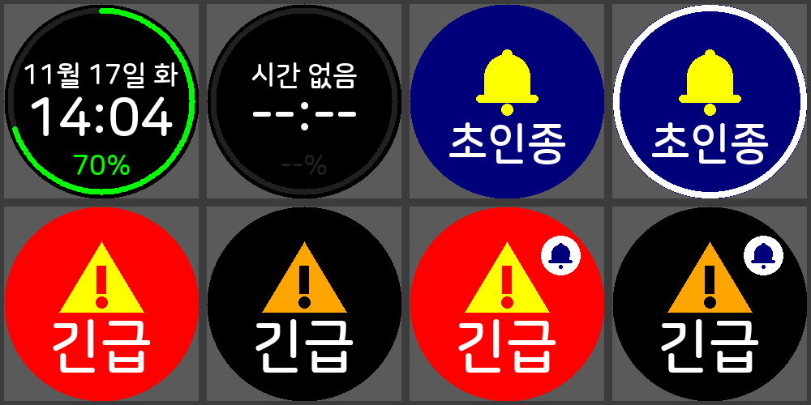

# Seeed Studio XIAO ESP32-C6 수신부

이 디렉터리는 **수신부 제품용 통신 펌웨어의 ESP-IDF 프로젝트**입니다. 2026-11-17에 수신부 보드를 ESP32-C3 SuperMini에서 **Seeed Studio XIAO ESP32-C6**으로 바꿨고, 디렉터리도 `receiver_c3/`에서 `receiver_c6/`로 옮겼습니다. 아래 본문의 "C6"는 수신부 보드를 뜻합니다.

C6는 S3 SoftAP에 STA로 접속한 상태를 유지하면서 Modem-sleep(MIN_MODEM)과 자동 Light-sleep을 씁니다. EVENT를 받으면 검증·중복 확인을 거쳐 UI 알림 큐에 접수하고, **UI가 그 알림 화면을 LCD로 다 보낸 뒤에 ACK**합니다(2026-11-17). 화면(GC9A01 원형 LCD)·진동모터·버튼·배터리 표시는 브레드보드 데모(`receiver_demo_final.ino`)의 디자인을 그대로 옮겨 구현했습니다.

## C3 → C6 변경 내용 (2026-11-17)

| 항목 | C3 SuperMini (이전) | XIAO ESP32-C6 (현재) |
| --- | --- | --- |
| 빌드 타깃 | `esp32c3` | `esp32c6` (`sdkconfig.defaults`). 다른 타깃으로 빌드하면 `ha_receiver.c`가 컴파일 오류를 냄 |
| 플래시·콘솔 | 4MB, USB Serial/JTAG | 4MB, USB Serial/JTAG (설정 동일) |
| 안테나 | 보드 안테나 고정 | **RF 스위치**: GPIO3 LOW = 스위치 제어 켬, GPIO14 LOW = 보드 세라믹 안테나 / HIGH = U.FL 외부 안테나(Seeed wiki). Wi-Fi 시작 전에 두 핀을 출력으로 설정하고 `gpio_hold_en()`으로 Light-sleep 동안 유지. menuconfig `HA_RX_ANTENNA`(기본: 보드 안테나) |
| 송신 출력 | 11dBm 제한(SuperMini 인증 시간 초과 우회, 2026-10 비교 결과) | 기본 **제한 없음**(ESP-IDF 기본값). 그 우회값은 SuperMini에서만 측정한 값이라 가져오지 않음. 필요하면 menuconfig `HA_RX_MAX_TX_POWER_QDBM`(0.25dBm 단위, 0 = 기본값) |
| 절전 | PM 40~160MHz, tickless idle, MIN_MODEM | 같음. C6도 최대 160MHz, XTAL 40MHz |
| 프로토콜·공통 코어 | — | 바꾸지 않음. S3 펌웨어 변경 없음 |

**바꾸지 않은 이름:** 통신 공통 코어(`ha_comm`)와 S3의 식별자·로그 태그(`c3_session`, `HA_HELLO_C3_REBOOTED`, S3 로그의 `C3_PM`·`C3_STATE`), 모니터 스크립트의 `HEARING_C3_PORT`·`c3.log`는 "수신부"라는 뜻으로 그대로 둡니다. 로그 분석 도구와 지난 시험 기록이 이 이름을 쓰기 때문입니다.

**검증 상태:** C6 빌드, PC 시험, C6 단독 부팅(LCD·모터·버튼 미연결)까지 확인했습니다. 무선 송수신·화면·진동·절전은 실기기 미검증입니다. C3에서 측정한 접속·절전·ACK 결과(2026-10-30, 2026-11-11 기록)는 C6에 그대로 적용되지 않습니다. 결과와 실기기 시험 절차는 [C6 수신부 검증 기록](../../docs/test_results/receiver_c6_2026-11-17.md)에 있습니다.

## 핀 배치

2026-11-17 XIAO ESP32-C6 핀맵을 Kconfig 기본값으로 넣었습니다(menuconfig → *Hearing Alert C6 UI*). 핀을 바꾸면 menuconfig에서 고치고, `-1`로 두면 그 부품을 쓰지 않습니다.

| XIAO 핀 | GPIO | 용도 | Kconfig |
| --- | --- | --- | --- |
| D0 | GPIO0 | 배터리 분압 (ADC) | `HA_UI_GPIO_BATT_ADC` |
| D1 | GPIO1 | 버튼 S (누르면 LOW) | `HA_UI_GPIO_BUTTON` |
| D2 | GPIO2 | 진동모터 (1kΩ → NPN 베이스) | `HA_UI_GPIO_MOTOR` |
| D3 | GPIO21 | LCD BLK (백라이트) | `HA_DISP_GPIO_BLK` |
| D4 | GPIO22 | LCD CS | `HA_DISP_GPIO_CS` |
| D5 | GPIO23 | LCD DC | `HA_DISP_GPIO_DC` |
| D6 | GPIO16 | 미사용 (UART0 TX, 부팅 로그) | — |
| D7 | GPIO17 | LCD RES | `HA_DISP_GPIO_RST` |
| D8 | GPIO19 | LCD SCL (SPI SCK) | `HA_DISP_GPIO_SCK` |
| D9 | GPIO20 | 미사용 (예비) | — |
| D10 | GPIO18 | LCD SDA (SPI MOSI) | `HA_DISP_GPIO_MOSI` |
| 3V3 | — | LCD·버튼·모터 VCC | — |
| 5V | — | 미사용 (USB 입력) | — |

보드 내부 전용 핀: GPIO3·GPIO14(RF 스위치, 위 표), GPIO9(BOOT 버튼), GPIO15(사용자 LED). 다른 용도로 쓰지 않습니다. 안테나 끝은 옆벽 방향으로 둡니다(핀맵 메모).

> 핀 기준은 **2026-11-17 핀맵 이미지(위 표)**입니다. 데모 코드(`receiver_demo_final.ino`)의 핀 번호(버튼 G4, 모터 G5, DC G6 등)는 브레드보드 **임시 배선**이라 펌웨어 기본값으로 쓰지 않습니다. 핀맵이 바뀌면 위 표와 Kconfig 기본값을 함께 고칩니다.

## 구성

| 경로 | 내용 |
| --- | --- |
| `main/main.c` | 시작 순서: 모터 핀 끄기 → `ha_receiver_start()` → `ha_ui_start()` |
| `components/ha_receiver/` | STA·절전·UDP 수신·중복 억제·**화면 표시 후 ACK**(`ha_receiver_alert_displayed()`) |
| `components/ha_ui_core/` | ESP-IDF 없이 도는 순수 C. 알림 우선순위 상태 머신(presenter), 진동 패턴 표, 화면 4종, 띠(band) 단위 그리기, 한글 글꼴, 시계 문자열. PC 시험 `test/host/run_tests.sh` |
| `components/ha_display/` | GC9A01 초기화(Espressif `esp_lcd_gc9a01` 레지스터 표)와 화면 전송. 프레임 버퍼 없이 9.6KB 버퍼 2개로 20줄씩 그려 보냄 |
| `components/ha_haptic/` | 진동 패턴 재생 작업. GPIO on/off, 새 명령이 오면 바로 끊고 바꿈, 안전 정지 시간 |
| `components/ha_ui/` | UI 작업·알림 전달 작업·화면 감시(`ui_guard`)·버튼(디바운스, Light-sleep 깨우기)·배터리 ADC·Kconfig |
| `../common/ha_comm/` | 프로토콜·중복 억제·시각 상태·**표시 대기 표(`ha_rx_pending`)** 공통 코어 |

## 빌드

```bash
source ~/esp/esp-idf/export.sh            # ESP-IDF v5.5.5
idf.py -C firmware/receiver_c6 -B firmware/receiver_c6/build build
idf.py -C firmware/receiver_c6 -B firmware/receiver_c6/build -p C6_PORT flash monitor
idf.py -C firmware/receiver_c6 -B firmware/receiver_c6/build menuconfig   # 핀·시간·시연 옵션
```

`sdkconfig.defaults`에서 `CONFIG_PM_ENABLE`, `CONFIG_FREERTOS_USE_TICKLESS_IDLE`, `CONFIG_PM_PROFILING`을 켜고, USB 연결이 Light-sleep을 막지 않게 설정합니다. 이 값들이 꺼져 있으면 컴파일 오류가 나서, 절전 없는 빌드가 만들어지지 않습니다. 부팅 15초 뒤 자동 Light-sleep을 켜며, 그 뒤로 USB 콘솔이 멈출 수 있습니다. 상태는 S3 로그의 `C3_PM`·`C3_STATE`(수신부 상태 보고, 이름 유지)로 확인합니다. 화면이 켜져 있어도 그리는 순간만 깨어나므로 Light-sleep은 유지되지만, 백라이트 전류는 따로 듭니다(`HA_UI_IDLE_BACKLIGHT_OFF_S`).

## 화면과 진동 (데모 디자인 유지)



PC 시험이 그린 실제 화면 데이터입니다(회색 바깥은 원형 LCD에서 보이지 않는 부분). 위 줄: 워치페이스, 시각 없음, 초인종(테두리 꺼짐/켜짐). 아래 줄: 긴급(빨강/검정 깜빡임), 화재 중 초인종(오른쪽 위 벨 배지).

| 상황 | 화면 | 진동 | 돌아가는 조건 |
| --- | --- | --- | --- |
| 평상시 | 워치페이스: 날짜·요일, 시각, 배터리 링·% | 없음 | — |
| 초인종 | 남색 배경, 노란 벨, "초인종", 흰 테두리 400ms 깜빡임 | 180ms 진동 5회, 사이에 220ms 쉼 | 버튼, 또는 `HA_UI_DOORBELL_HOLD_MS`(제안 15초) |
| 화재 | 빨강/검정 전체 400ms 깜빡임, 경고 표지, "긴급" | 350ms 켜짐 / 100ms 꺼짐 반복 | 버튼, 또는 `HA_UI_FIRE_HOLD_MS`(제안 60초) |
| 초인종 중 화재 | 초인종을 바로 끊고 화재 화면 + 벨 배지 | 화재 패턴 | 화재와 같음 |
| 화재 중 초인종 | 화재 화면 유지 + 벨 배지 | 화재 패턴 유지 | 화재 시간 그대로 |
| 같은 알림 다시 옴 | 처음부터 다시 | 처음부터 다시 | 시간 연장 |

- 데모와 같은 좌표·색·아이콘입니다. 글자만 데모의 U8g2 unifont 확대(계단 모양) 대신 **나눔스퀘어라운드 Bold를 크기별로 미리 래스터화한 부드러운 글꼴**을 씁니다(`ha_ui_core/tools/gen_font.py`, 필요한 글자만 약 22KB). 화면에 새 글자를 넣으면 이 스크립트의 `GLYPH_SETS`에 추가하고 다시 실행합니다. 글꼴 데이터는 SIL OFL 1.1입니다(파일 머리말 참고).
- 진동은 데모 패턴의 세기가 0/255뿐이라 PWM 없이 GPIO로 켜고 끕니다. 그래서 Light-sleep 중에도 패턴이 유지됩니다. 어떤 패턴이든 `HA_UI_HAPTIC_MAX_MS`(기본 120초)가 지나면 멈춥니다.
- 부팅 때 짧게 한 번 진동합니다(`HA_UI_SELFTEST`).
- 버튼: 알림 중이면 진동을 끄고 워치페이스로 돌아갑니다. 평상시에는 화면을 켭니다(`HA_UI_IDLE_BACKLIGHT_OFF_S`를 쓸 때). Light-sleep 중에도 버튼으로 깨어납니다.

### 시각과 배터리

- **시각:** S3가 TIME_SYNC를 보내면 그 시각(KST, `HA_UI_UTC_OFFSET_MIN`=540)을 씁니다. **지금 S3에는 시각 출처가 없어서**, 기본 빌드에서는 데모의 "시간 없음 / --:--" 화면이 나옵니다. 데모처럼 빌드 시각으로 시계를 돌리려면 `HA_UI_DEMO_BUILD_TIME=y`(+`HA_UI_DEMO_BUILD_TIME_OFFSET_S`, 데모의 `UPLOAD_OFFSET_SEC`)를 켭니다. 진짜 시각이 아니므로 시연용으로만 씁니다.
- **배터리:** 분압 저항값이 확인되지 않아 기본은 측정하지 않고 "--%"를 표시합니다. 저항 두 개가 같으면 `HA_UI_BATT_DIVIDER_X100=200`으로 켭니다. 0%·100% 전압은 `HA_UI_BATT_EMPTY_MV`(3300)·`HA_UI_BATT_FULL_MV`(4200)이며 직선으로 환산합니다(실제 배터리 곡선은 측정 후 조정).
- **시연 모드:** `HA_UI_DEMO_BUTTON_CYCLE=y`이면 데모처럼 버튼으로 워치페이스 → 초인종 → 긴급 → 워치페이스를 넘깁니다. S3 없이 화면·진동만 보여 주는 용도이며 ACK와 관계없습니다.

## ACK 계약 — 화면에 뜬 뒤 ACK (2026-11-17)

정확히는 "알림 화면을 LCD로 다 보낸 뒤 ACK"입니다(아래 "ACK 의미"와 "한계" 참고).

```
S3 ──EVENT──▶ C6 수신 작업: 검증·중복 확인 → 알림 큐 + "표시 대기" 표에 기록 (ACK 안 보냄)
                    │
                    ▼
              UI 작업: 진동 시작 → 화면 그리기(마지막 픽셀까지 전송 완료)
                    │
                    ▼
              ha_receiver_alert_displayed() ──ACK──▶ S3 (재전송 멈춤)
```

| 항목 | 계약 |
| --- | --- |
| ACK 의미 | 기본 설정: **"C6가 그 알림 화면을 LCD로 오류 없이 다 보냈다"**. LCD에서 값을 읽는 선이 없어서, LCD가 빠졌거나 화면·백라이트가 고장 나도 C6는 알 수 없습니다. `HA_DISP_READBACK`을 켜면(보드 확인 필요) "LCD가 응답했고 표시 켜짐 상태다"까지 확인합니다. 어느 쪽이든 사용자가 봤다는 뜻은 아닙니다. 기존(2026-11-15) "큐에 접수됨"에서 바뀌었고, 프레임 형식과 S3 동작은 그대로입니다 |
| 화면 전 재전송 | S3가 ACK를 기다리며(700ms) 같은 EVENT를 다시 보내면, C6는 중복으로 알아보고 **알림을 다시 울리지 않고 ACK도 보내지 않습니다**(표시 대기 중). 화면이 그려지면 그때 ACK가 나갑니다. S3는 같은 이벤트를 계속 진행 중으로 들고 있으므로 늦은 ACK도 그대로 받습니다 |
| 화면 후 재전송 | ACK가 사라져 다시 온 EVENT는 예전처럼 알림 없이 ACK만 다시 보냅니다 |
| 화면 고장 | 진동은 울리지만 화면에 뜰 때까지 **ACK를 보내지 않습니다**. 아래 "화면 복구"가 자동으로 화면을 되살리거나 C6를 재부팅합니다. 진동도 화면도 안 되면 UI를 붙이지 않습니다(접수·ACK 없음) |
| 표시 대기 표 | 큐 길이+4(기본 12)개. 가득 차면 새 EVENT를 접수하지 않고(S3 재전송), 받은 지 그 이벤트의 TTL(화재 10분, 초인종 2분)이 지난 항목은 비웁니다. 그때는 S3도 이미 포기한 상태입니다 |
| 옛 방식 | `HA_RX_ACK_ON_DISPLAY=n`이면 큐 접수 시점에 ACK합니다(2026-11-15 방식) |
| 진단 소비자 | `HA_RX_DIAG_LOG_CONSUMER`는 실제 UI와 함께 켤 수 없습니다(컴파일 오류). 켜면 로그를 남긴 직후 확인 처리합니다 |
| 미등록 ID·TEST | 등록 테이블에 없는 ID와 0은 폐기합니다. TEST(진단 빌드 전용)는 화면이 없으므로 로그만 남기고 확인 처리합니다 |

### 화면 복구 (2026-11-17)

화면에 안 뜬 알림을 그대로 두지 않도록, 아래 단계를 차례로 밟습니다. 판단 규칙은 `ha_ui_core/ha_recovery.c`(PC 시험), 실행은 `ha_ui`의 `ui_guard` 작업이 맡습니다. `ui_guard`는 UI 작업과 따로 돌기 때문에 UI 작업이 멈춘 경우도 잡아냅니다.

| 단계 | 언제 | 하는 일 |
| --- | --- | --- |
| 1. 상태 재전송 | 알림을 그리기 직전, 매번 | SLPOUT·MADCTL·COLMOD·INVON·DISPON을 다시 보냄(약 6ms). 모터 전류나 정전기로 LCD가 혼자 리셋돼도 알림이 보이게 함 |
| 2. 즉시 재초기화 | 그리기가 실패하면 | RES 핀 리셋 + 전체 초기화(약 0.3초) 후 다시 그림 |
| 3. LCD 재초기화 요청 | 알림이 화면에 안 뜬 지 `HA_UI_RECOVER_AFTER_MS`(3초) | `ui_guard`가 UI 작업에 재초기화·다시 그리기를 요청. 성공하면 그때 ACK |
| 4. C6 재부팅 | 안 뜬 지 `HA_UI_REBOOT_AFTER_MS`(6초) | `esp_restart()`. S3는 그 이벤트를 TTL까지 들고 있으므로 C6가 다시 접속하면 재전송되고, 이번에 화면에 뜨면 ACK |
| 5. 진동 전용 모드 | 연속 재부팅 `HA_UI_MAX_RECOVERY_REBOOTS`(3회) 뒤 | 더 재부팅하지 않음(무한 재부팅 방지). 알림은 계속 진동하지만 ACK하지 않음. LCD는 `HA_UI_DISPLAY_RETRY_S`(60초)마다 재시도하고, 화면이 돌아오면 정상 모드로 복귀 |

- 연속 재부팅 횟수는 재부팅해도 지워지지 않는 LP RAM(`RTC_NOINIT`)에 두고, 알림이 화면에 한 번 뜨면 0으로 돌아갑니다. 전원을 껐다 켜도 0이 됩니다.
- 재부팅 직후 같은 알림이 다시 진동합니다(재부팅으로 중복 기록이 지워짐). 화면에 못 띄운 알림을 놓치는 것보다 낫다고 보았습니다.
- 재초기화로 되살아난 화면이 아직 그 알림을 보여 주는 중이면(예: 화재 화면) 그 알림을 그때 ACK합니다. 이미 시계 화면으로 돌아갔다면 ACK하지 않고 4단계로 넘어갑니다.
- 부팅 때 LCD 초기화가 실패하면 3번 다시 시도하고, 그래도 안 되면 백그라운드에서 60초마다 재시도합니다. 알림이 없으면 재부팅하지 않습니다.

**한계 — LCD가 빠졌는지는 기본 설정으로 알 수 없습니다.** 핀맵에 LCD에서 읽는 선(MISO)이 없어서, LCD가 빠져 있어도 SPI 전송은 "성공"합니다. 그래서 위 단계는 전송 오류와 멈춤만 잡습니다. 빠짐·멈춤까지 잡으려면 `HA_DISP_READBACK`을 켭니다. 이 옵션은 SDA 선 하나로 패널 상태(RDDPM)를 읽어서, 답이 이상하면 "화면에 안 뜸"으로 처리합니다. 읽기는 GC9A01의 읽기 속도 한계(약 6.6MHz) 때문에 그 순간만 4MHz로 낮춰서 하고, SDA에 내부 풀업을 걸어 LCD가 없으면 항상 `0xff`가 읽히게 했습니다.

벤치 확인(2026-11-17): LCD가 없을 때 모든 값이 `0xff`로 고정돼 "응답 없음"으로 판정되는 것까지 확인했습니다. LCD를 연결한 상태의 확인(부팅 로그 `probe` 줄에서 `RDDMADCTL=0x08`, `RDDPM=0x9c`)은 아직이며, 그 전까지 기본값은 꺼 둡니다. 절차는 [검증 기록](../../docs/test_results/receiver_c6_2026-11-17.md) 6번입니다.

로그로 보는 순서: `EVENT accepted … ; ACK after display` → `ha_ui: screen FIRE` → `EVENT displayed … -> ACK (N ms after reception)`. S3 쪽은 기존처럼 `ACK seq=…`가 찍힙니다.

## 시험

```bash
bash firmware/common/ha_comm/test/host/run_tests.sh                      # 통신 코어 + 표시 대기 표
bash firmware/receiver_c6/components/ha_ui_core/test/host/run_tests.sh   # 우선순위·복구 단계·시계·글꼴·화면
bash firmware/receiver_c6/components/ha_ui_core/test/host/run_tests.sh /tmp/c6_preview   # 화면 PPM 저장
```

화면 시험은 띠 단위(20줄, 7줄)와 일부 영역 그리기가 한 번에 그린 결과와 픽셀까지 같은지 확인합니다. **실제 LCD·모터·버튼 동작은 보드에서 확인해야 합니다**(색 반전·방향이 다르면 `HA_DISP_INVERT`, `HA_DISP_MADCTL`).

## 300ms 목표 수신 간격의 구현

| 구분 | 내용 |
| --- | --- |
| 목표 | 약 300ms 간격의 주기적 Wake-up (2026-11-10 회의) |
| 실제 설정 | S3 AP `beacon_interval=100` TU, `dtim_period=3`. C6 `WIFI_PS_MIN_MODEM` (ESP-IDF v5.5.5 헤더: “station wakes up to receive beacon every DTIM period”) |
| 명목 간격 | 100 × 1.024ms × 3 = **307.2ms**. 정확히 300ms는 설정할 수 없습니다. `beacon_interval`은 100 TU의 배수만 허용되므로, 가장 가까운 값을 골랐습니다(+2.4%) |
| 이전 값 | DTIM=1, 102.4ms (TEST 펌웨어 2026-10-30 측정 조건) |
| `listen_interval` | 3으로 설정했지만 MAX_MODEM에서만 수신 간격을 결정합니다. MIN_MODEM에서는 AP의 DTIM을 따릅니다 |
| CPU | `esp_pm` 40~160MHz, tickless idle, 자동 Light-sleep. 수동 `esp_light_sleep_start()` 반복이나 Deep-sleep은 쓰지 않습니다 |
| 수신 구조 | AP가 절전 중인 STA로 가는 유니캐스트를 버퍼링하고, C6는 DTIM 비콘의 TIM을 보고 수신합니다. AP 버퍼의 크기·보존 시간은 보장되지 않으므로, S3의 반복 송신과 ACK로 보완합니다 |

**검증 상태:** 다음 항목은 C6에서 **실기기 미검증**입니다.
- 실제 절전 진입(`C3_PM sleep_count` 증가)
- 약 307ms 수신 기회가 실제로 생기는지(ACK 왕복 지연 분포로 간접 확인)
- 소비전류(전류계로 별도 측정)

`vTaskDelay(300)`이나 소켓 timeout은 절전 주기 설정이 아니어서 사용하지 않았습니다.
